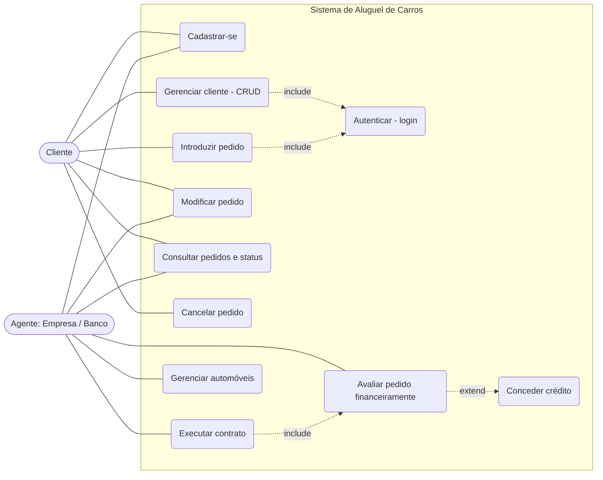
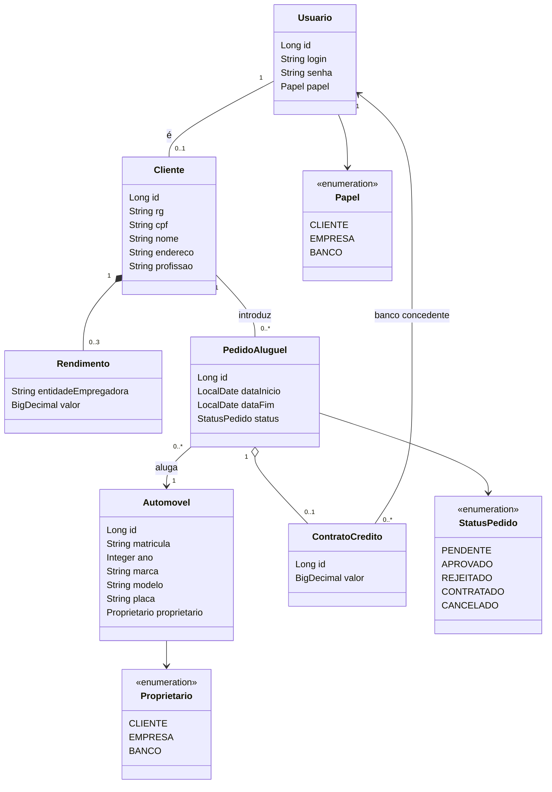
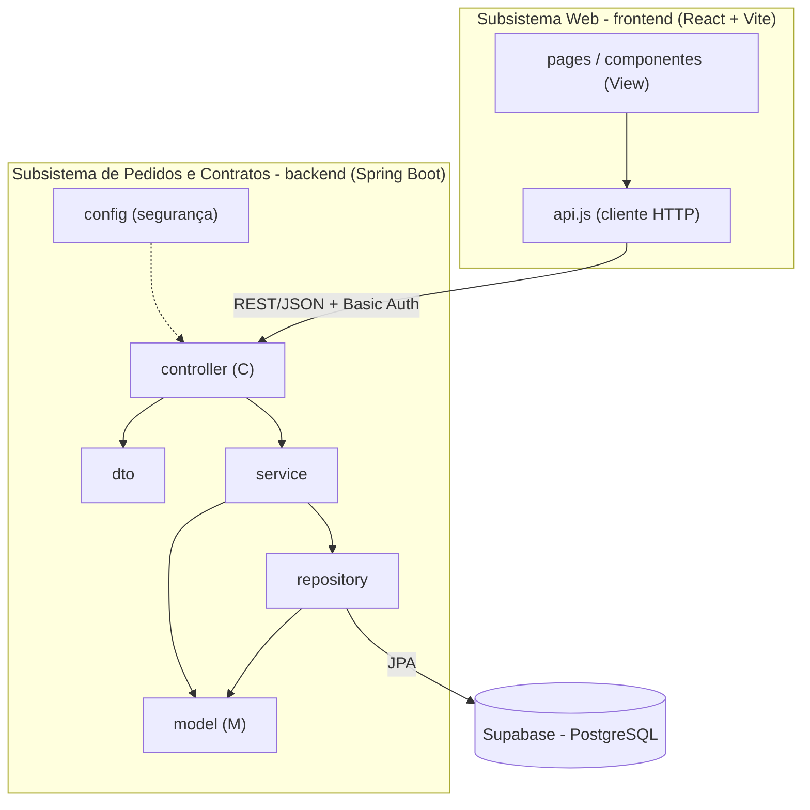

# Modelagem do Sistema — Aluguel de Carros

Diagramas em Mermaid (renderizados automaticamente pelo GitHub). Versão **v1.0**; atualizar este arquivo a cada revisão do modelo.

## 1. Diagrama de Casos de Uso

> `UC9 Conceder crédito` é exclusivo de agentes do tipo Banco.

## 2. Diagrama de Classes

Ciclo de vida do pedido: `PENDENTE → APROVADO → CONTRATADO`; `PENDENTE → REJEITADO`; `CANCELADO` (cliente, antes do contrato).

## 3. Diagrama de Pacotes (Visão Lógica — MVC)

Dois subsistemas: **gestão de pedidos e contratos** (back-end Spring Boot) e **construção dinâmica das páginas web** (front-end React + Vite).

## 4. Mapeamento modelo ↔ código

| Modelo | Código (`backend/src/main/java/com/aluguel`) |
|---|---|
| Classes de domínio | `model/*` |
| Pacotes | `controller`, `service`, `repository`, `dto`, `model`, `config` |
| UC1/UC2 | `AuthController`, `UsuarioService`, `SecurityConfig` |
| UC3 | `ClienteController`, `ClienteService` |
| UC4–UC7 | `PedidoController`, `PedidoService` |
| UC8–UC10 | `PedidoService.avaliar` / `contratar` |
| UC11 | `AutomovelController` |
